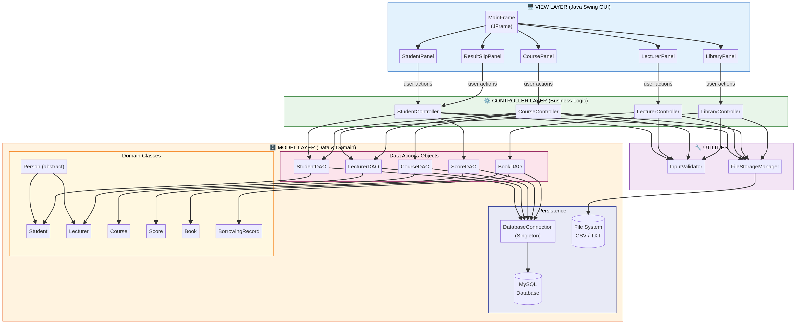
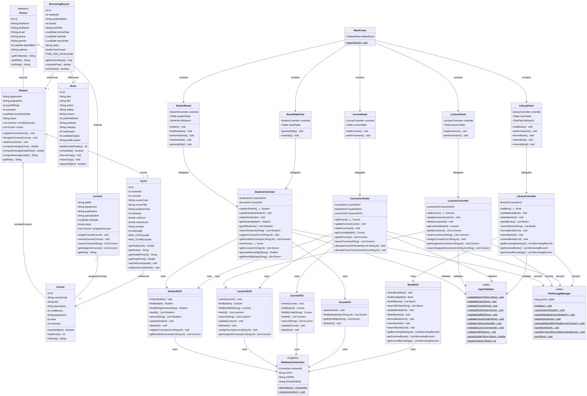
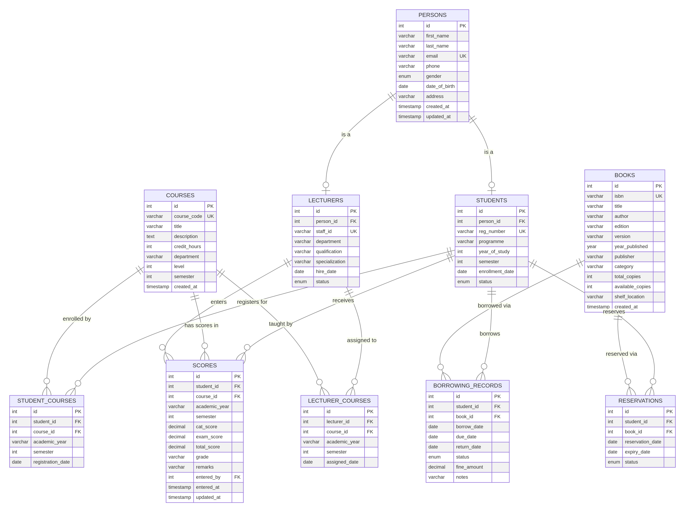

# Student Management System – Project Documentation

**Author:** Manus AI  
**Date:** March 2026  
**Course:** Object-Oriented Programming (Java)

---

## 1. Introduction

The Student Management System (SMS) is a comprehensive desktop application designed to streamline the administrative operations of an educational institution. Built using Java and MySQL, the system provides robust modules for managing students, lecturers, courses, academic scores, and library resources. 

The project strictly adheres to Object-Oriented Programming (OOP) principles and the Model-View-Controller (MVC) architectural pattern, ensuring a modular, scalable, and maintainable codebase suitable for academic submission.

---

## 2. System Architecture (MVC Pattern)

The system is built on the **Model-View-Controller (MVC)** design pattern, which separates the application into three interconnected components. This separation of concerns allows for independent development, testing, and maintenance of the user interface, business logic, and data access layers.

### 2.1 The Model Layer
The Model layer represents the data and the business rules of the application. It is further subdivided into:
*   **Domain Classes:** Plain Old Java Objects (POJOs) that represent the core entities of the system. The base class `Person` is extended by `Student` and `Lecturer`, demonstrating inheritance. Other domain classes include `Course`, `Score`, `Book`, and `BorrowingRecord`.
*   **Data Access Objects (DAOs):** Classes responsible for interacting with the MySQL database. They encapsulate all SQL queries (CRUD operations) and map result sets to domain objects. Examples include `StudentDAO`, `CourseDAO`, and `BookDAO`.
*   **Persistence Utilities:** The `DatabaseConnection` class implements the Singleton pattern to manage a single, shared connection to the MySQL database. The `FileStorageManager` simulates a secondary persistence mechanism by writing logs and result slips to the local file system.

### 2.2 The View Layer
The View layer is responsible for presenting data to the user and capturing user input. It is implemented using **Java Swing**.
*   The `MainFrame` serves as the primary container, utilizing a `JTabbedPane` to organize the interface into distinct functional areas.
*   Individual panels (`StudentPanel`, `LecturerPanel`, `CoursePanel`, `LibraryPanel`, `ResultSlipPanel`) handle specific modules.
*   The `UITheme` utility class ensures a consistent, professional visual design across all components by centralizing color palettes, fonts, and component styling.

### 2.3 The Controller Layer
The Controller layer acts as the intermediary between the View and the Model. It processes user input from the View, applies business logic and validation, and updates the Model accordingly.
*   Controllers such as `StudentController` and `LibraryController` enforce rules (e.g., a student can only register for exactly 5 courses, or a book cannot be borrowed if no copies are available).
*   The `InputValidator` utility is heavily utilized by controllers to ensure data integrity before any database operations are attempted.

---

## 3. Object-Oriented Design

The system leverages core OOP principles to create a robust and extensible design.

### 3.1 Inheritance
The `Person` class serves as an abstract base class containing common attributes such as `firstName`, `lastName`, `email`, and `phone`. The `Student` and `Lecturer` classes inherit from `Person`, adding specific attributes like `regNumber` for students and `staffId` for lecturers.

### 3.2 Encapsulation
All domain classes use private fields accessed via public getter and setter methods. This protects the internal state of the objects and allows for validation logic to be added in the future without changing the public API.

### 3.3 Polymorphism
The abstract `Person` class defines an abstract method `getRole()`. The `Student` and `Lecturer` classes provide their own specific implementations of this method, allowing them to be treated polymorphically when necessary.

---

## 4. Database Design

The system utilizes a relational MySQL database to ensure data persistence, integrity, and complex querying capabilities.

### 4.1 Schema Overview
The database schema is highly normalized to prevent data redundancy. Key tables include:
*   **`PERSONS`**: Stores common personal information.
*   **`STUDENTS` & `LECTURERS`**: Store role-specific data and maintain a foreign key relationship with the `PERSONS` table.
*   **`COURSES`**: Stores course catalog information.
*   **`STUDENT_COURSES` & `LECTURER_COURSES`**: Junction tables that resolve the many-to-many relationships between students/lecturers and courses.
*   **`SCORES`**: Records academic performance, linking students to courses.
*   **`BOOKS` & `BORROWING_RECORDS`**: Manage the library inventory and track the lifecycle of borrowed items.

### 4.2 Stored Procedures and Triggers
To enforce complex business rules at the database level, the schema includes:
*   **Stored Procedure `RegisterStudentCourse`**: Ensures that a student cannot register for more than 5 courses in a single semester. It throws an SQL exception if the limit is exceeded.
*   **Triggers on `BORROWING_RECORDS`**: Automatically decrement the `available_copies` in the `BOOKS` table when a book is borrowed, and increment it when the book is returned.

---

## 5. System Workflow

The following outlines the step-by-step workflow for key operations within the system.

### 5.1 Student Registration and Course Allocation
1.  The administrator navigates to the **Students** tab and enters the student's details.
2.  The `StudentPanel` captures the input and passes it to the `StudentController`.
3.  The controller validates the input using `InputValidator`. If valid, it creates a `Student` object and passes it to the `StudentDAO`.
4.  The DAO executes an `INSERT` query to save the record in the MySQL database.
5.  To allocate courses, the administrator navigates to the **Courses** tab, selects a course, and enters the Student ID.
6.  The `CourseController` invokes the `RegisterStudentCourse` stored procedure via the DAO, which enforces the 5-course limit before saving the allocation.

### 5.2 Score Entry and Result Slip Generation
1.  In the **Students** tab, the administrator selects a student and navigates to the "Scores" sub-tab.
2.  Scores for Continuous Assessment Tests (CAT, max 30) and Exams (max 70) are entered for a specific course.
3.  The `Score` domain object automatically computes the total score, grade (A, B, C, D, F), and grade point based on predefined academic rules.
4.  The `ScoreDAO` saves the record to the database.
5.  In the **Result Slip** tab, entering a student's registration number triggers the `StudentController` to fetch all scores.
6.  The system computes the overall average score and average grade, displaying a formatted result slip.
7.  Clicking "Save to File" utilizes the `FileStorageManager` to write the result slip to a text file in the local file system.

### 5.3 Library Management
1.  The **Library** tab features a real-time search bar. As the user types, a `DocumentListener` triggers the `LibraryController` to query the database and update the table instantly.
2.  To borrow a book, the administrator enters a Student ID and selects a book.
3.  The `LibraryController` checks availability. If `available_copies > 0`, the `BookDAO` creates a `BORROWING_RECORD`. A database trigger automatically updates the book's inventory.
4.  If no copies are available, the controller throws an `IllegalStateException`. The View catches this and prompts the user to reserve the book instead.
5.  The system automatically calculates fines for overdue books based on the difference between the current date and the due date.

---

## 6. Conclusion

The Student Management System successfully implements all required features using a strict MVC architecture and robust OOP principles. The integration of a normalized MySQL database with Swing-based GUI components provides a seamless and efficient user experience. The inclusion of file-based persistence for logging and result slips demonstrates the system's capability to interact with multiple data storage mechanisms. This project serves as a comprehensive demonstration of enterprise-level Java application development.
